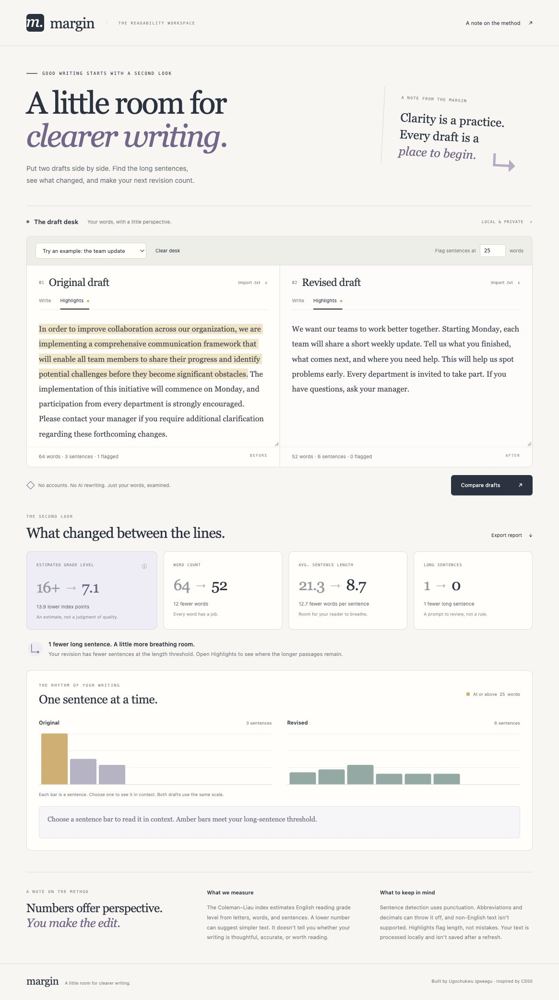

# Margin walkthrough

Run `python3 server.py` from the repository root and open the printed URL. No package installation or API key is required.

## The team update

The original sample begins with a 34-word sentence. It describes a simple change using phrases such as “comprehensive communication framework.” The revision explains the change in shorter, more direct sentences.

At the default 25-word threshold:

| Measure | Original | Revised |
| --- | --- | --- |
| Words | 64 | 52 |
| Sentences | 3 | 6 |
| Long sentences | 1 | 0 |
| Average words per sentence | 21.33 | 8.67 |

Open Highlights to see the original’s long opening sentence. The grade estimate changes too, but the tool does not claim that shorter writing is always better. You decide whether a revision communicates what you mean.



## Browser verification checklist

- The default sample reports 64 original words and 52 revised words.
- Highlights marks one original sentence and no revised sentences at the 25-word threshold.
- Selecting the first original chart bar selects the same 34-word sentence in the preview and detail panel.
- Editing a draft marks results as stale and disables export and sentence selection until the next comparison.
- Custom text beginning with an emoji preserves exact sentence boundaries in the highlights.
- A threshold of three flags sentences with exactly three words.
- An empty revision reports a missing grade as a dash, not zero.
- A threshold of zero displays a validation message without replacing valid results.
- Importing the original example `.txt` file fills the editor and marks results as stale.
- A downloaded JSON report contains both draft texts, the threshold, 64 original words, and 52 revised words.
- The narrow mobile layout stacks the editors and comparison cards without horizontal document overflow.
- The verified browser flows produce no JavaScript errors.

## Mobile

[Open the full mobile screenshot](mobile.jpg).

## Automated checks

```sh
python3 -m unittest discover -s tests -v
```

The suite includes reference calculations and exact result parity between the HTTP API and CLI. It also checks Unicode spans, empty drafts, boundaries, invalid inputs, and local-server request handling. Screenshots use the app’s original demonstration text.
